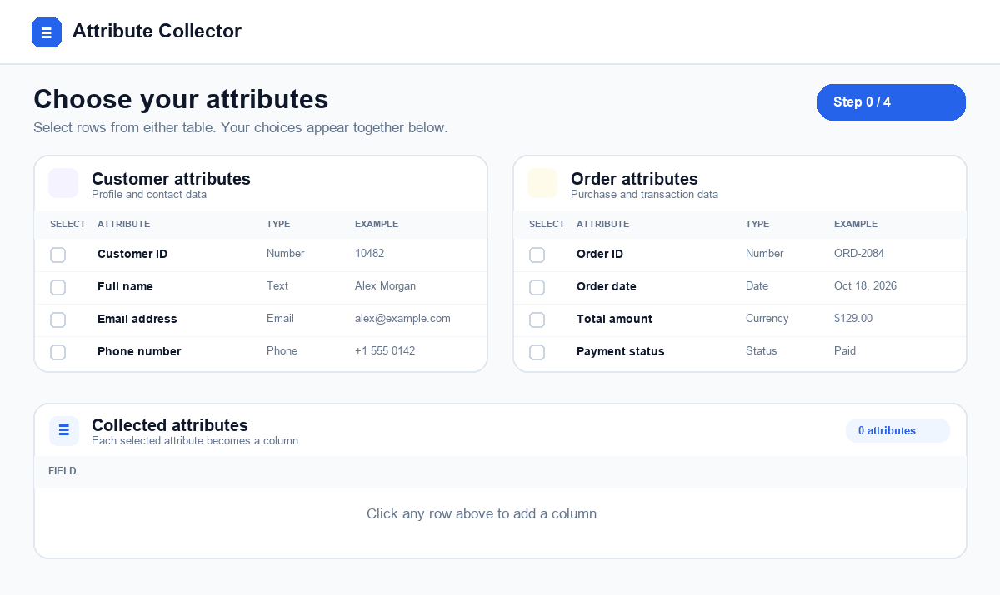

# Attribute Collector

Choose attributes from two tables and collect them as columns in a third table.

## Animated preview

The preview illustrates selecting customer and order attributes and seeing them appear as columns below.

## Open the interactive page

Download or clone this repository, then open [`dist/index.html`](dist/index.html) in your browser. GitHub shows HTML files as source code, so use a local browser to interact with the page.

## Features

- Select attributes from customer and order tables.
- Search either table.
- Drag selected columns to reorder them, or use the left and right buttons.
- Keep selections and column order after a refresh.
- Export selected columns and example values as CSV.
- Enjoy subtle transitions, with support for reduced-motion settings.

The page needs an internet connection to load Tailwind CSS and Lucide icons from their CDNs. No installation or build step is required.
